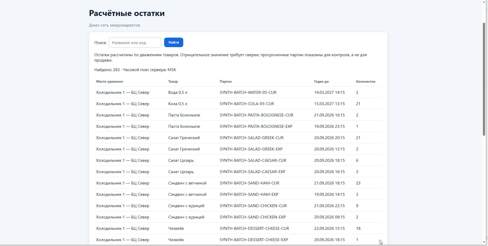
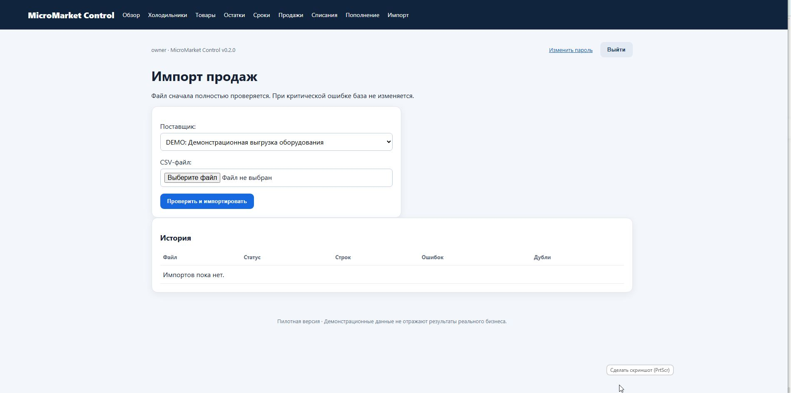

# MicroMarket Control v0.2.0

> CRM-система для управления сетью микромаркетов с автоматическими рекомендациями пополнения, учётом партий по FEFO и дашбордом собственника. **Детерминированные алгоритмы — ИИ-агент на следующем этапе.**

| Характеристика | Значение |
| --- | --- |
| Версия | 0.2.0 |
| Лицензия | Частный проект (portfolio only) |
| Язык | Python 3.12–3.14 |
| Фреймворк | Django 5.2 |
| БД | SQLite (локально) / PostgreSQL 16 (продакшн) |
| Контейнеризация | Docker Compose |

---

## 📋 Назначение и бизнес-проблема

**Микромаркет** — это автономная торговая витрина с холодильным оборудованием (без персонала). Владельцы сети сталкиваются с:

- **Потерей выручки** — товар заканчивается, витрина простаивает.
- **Списаниями** — продукты просрочены, но об этом узнают постфактум.
- **Ручным учётом** — данные с оборудования приходят в CSV, сопоставление с остатками — в Excel.
- **Отсутствием прозрачности** — владелец не знает маржу, списания и тренды без выгрузки от вендора.

**MicroMarket Control** решает эту проблему, объединяя:

1. Импорт продаж из CSV (атомарная валидация без дублей).
2. Учёт остатков по движениям (двойные транзакции, каждая операция фиксируется).
3. Контроль сроков годности (FEFO — First-Expired-First-Out).
4. Расчёт рекомендаций к пополнению (взвешенный алгоритм с объяснением).
5. Дашборд собственника (выручка, маржа, списания, тренды за 30 дней).

> ⚠️ **Это демонстрационный пилот, а не промышленная система.** Все данные в репозитории — синтетические. Реальных клиентов, организаций или персональных данных нет.

---

## 🧠 ИИ и алгоритмы: что реализовано, а что нет

### ✅ Реализовано: детерминированный расчёт рекомендаций

Модель `weighted-v1` — **не нейросеть и не LLM**, а линейная формула на чистом Python:

```text
daily_demand = 0.6 × (среднее по тем же дням недели за 4 недели)
               + 0.4 × (среднее за последние 14 дней)

replenish = max(0, daily_demand × 2 дня × 1.15 — usable_stock)
```

Результат **полностью воспроизводим**: в каждой рекомендации есть JSON `explanation` с исходными числами.

### ❌ НЕ реализовано

| Что | Статус |
| --- | --- |
| LLM (OpenAI, Anthropic, Ollama и т.д.) | Не подключены, в зависимостях отсутствуют |
| Нейросети / машинное обучение | Нет зависимостей (torch, sklearn, scikit-learn) |
| AI-агенты | Не реализованы |
| Внешние AI API | Не используются |
| Интеграция с amoCRM | Не реализована |
| Автоматические push-уведомления | Telegram-бот работает в режиме `polling`, команды `/start` и `/replenishment` |

**Telegram-бот — не ИИ.** Он использует `aiogram` — фреймворк для Telegram Bot API, просто читает таблицу `Forecast` из БД.

**Для хакатона по ИИ-агентам:** проект демонстрирует **готовую структуру данных**, поверх которой можно надстроить агента (см. раздел «Потенциал развития»).

---

## ✨ Ключевые возможности

### Управление номенклатурой

| Функция | Статус |
| --- | --- |
| Организации и точки | ✅ Реализовано |
| Поставщики оборудования | ✅ Реализовано |
| Товары и SKU | ✅ Реализовано |
| Партии и сроки годности | ✅ Реализовано |
| QR-токены холодильников | ✅ Реализовано |

### Учёт и аналитика

| Функция | Статус |
| --- | --- |
| Двойные транзакции (перемещения) | ✅ Реализовано |
| Остатки по движениям (без потерь) | ✅ Реализовано |
| Атомарный CSV-импорт (SHA-256 защита от дублей) | ✅ Реализовано |
| Расчёт FEFO (First-Expired-First-Out) | ✅ Реализовано |
| Дашборд (выручка, маржа, списания за 30 дней) | ✅ Реализовано |
| Рекомендации к пополнению (weighted-v1) | ✅ Реализовано |
| Контроль сроков годности (48 часов) | ✅ Реализовано |

### Роли и доступ

| Функция | Статус |
| --- | --- |
| Владелец / Оператор / Мерчендайзер | ✅ Реализовано |
| Портал — только чтение для владельца | ✅ Реализовано |
| Admin-панель — только superuser | ✅ Реализовано |
| Telegram-бот (команды /start, /replenishment) | ✅ Реализовано |

### Инфраструктура

| Функция | Статус |
| --- | --- |
| Docker Compose (Postgres + Gunicorn + Nginx) | ✅ Реализовано |
| HTTPS (TLS, rate-limiting входа) | ✅ Реализовано |
| Автоматические дампы (pg_dump) | ✅ Реализовано |
| Проверка восстановления дампа | ✅ Реализовано |
| Bootstrap-команда для безопасного старта | ✅ Реализовано |

---

## 🛠 Технологии

| Слой | Технология |
| --- | --- |
| Backend | Python 3.12, Django 5.2 |
| Frontend | HTML-шаблоны Django, кастомный CSS (`app.css`, `portal.css`) |
| БД | SQLite (dev), PostgreSQL 16 (prod) |
| Контейнеры | Docker, Docker Compose |
| Веб-сервер | Gunicorn, Nginx |
| Статика | WhiteNoise (библиотека Python для обслуживания static-файлов) |
| Бот | aiogram 3.22 (Telegram Bot API) |
| Тесты | pytest, pytest-django |
| Линтер | Ruff |

---

## 🏗 Архитектура

```text
┌─────────────────────────────────────────────────────┐
│                   Nginx (HTTPS)                      │
│              127.0.0.1:8443 → rate-limit             │
└──────────────────────┬──────────────────────────────┘
                       │
┌──────────────────────▼──────────────────────────────┐
│              Gunicorn (Django WSGI)                  │
│              Python 3.12 / Django 5.2                │
└──────────────────────┬──────────────────────────────┘
                       │
┌──────────────────────▼──────────────────────────────┐
│           PostgreSQL 16 (volume: pgdata)             │
└─────────────────────────────────────────────────────┘
```

### Локальный режим (Windows)

```text
Python 3.12–3.14 → Django runserver → SQLite (db.sqlite3)
```

---

## 📊 Примеры использования

### Сценарий 1: «Утро оператора»

1. Оператор загружает CSV с витрины F-001 через `/imports/sales/`.
2. Система атомарно валидирует файл: проверяет поставщика, SKU, холодильник, даты, суммы.
3. При ошибке — ни одна строка не сохраняется. При успехе — дубли через SHA-256 отбрасываются.
4. Партии распределяются по FEFO (первым истекающий срок).
5. Остатки обновляются автоматически.

### Сценарий 2: «Контроль сроков»

1. Владельцу на дашборде видно: «3 партии истекают в течение 48 часов».
2. На странице `/records/batches/` — полный список с сортировкой по `expires_at`.
3. Для каждой партии: товар, номер, дата годности, статус (ACTIVE/BLOCKED/EXPIRED).

### Сценарий 3: «Еженедельный анализ»

1. Владелец открывает дашборд → видит выручку, валовую прибыль, % списаний за 30 дней.
2. Раздел «Выручка по точкам» — ранжирование витрин.
3. Раздел «Рекомендации» — что нужно заказать и куда.
4. Telegram-бот: команда `/replenishment` — тот же список рекомендаций.

### Сценарий 4: «Сверка остатков»

1. `/records/stock/` — расчётные остатки по каждому месту хранения и партии.
2. Отрицательное значение = расхождение, требует физической инвентаризации.
3. Остатки считаются **только по движениям** — никаких «магических» чисел.

### Сценарий 5: «Повторный импорт»

1. Оператор дважды загружает один и тот же CSV.
2. Второй раз система отвечает: «Этот файл уже был импортирован. Дубли не созданы.»
3. Запрос `file_hash` в `ImportJob` обеспечивает защиту от дублирования.

---

## 🚀 Быстрый запуск

### Требования

- **Windows:** Python 3.12–3.14
- **Linux:** Python 3.12, Docker Engine + Compose v2
- **macOS:** Python 3.12, Docker Desktop

### Вариант 1: Автоустановка (Windows)

```powershell
# 1. Установка
.\install_demo.bat

# 2. Запуск
.\start_demo.bat

# 3. Вход в браузере http://127.0.0.1:8000/
#    Логин: demo
#    Пароль: demo12345
```

### Вариант 2: Ручная установка

```powershell
# 1. Виртуальное окружение
python -m venv .venv
.\.venv\Scripts\python.exe -m pip install --upgrade pip setuptools wheel

# 2. Зависимости
.\.venv\Scripts\python.exe -m pip install -r requirements-web.txt

# 3. Миграции и демо-данные
.\.venv\Scripts\python.exe manage.py migrate
.\.venv\Scripts\python.exe manage.py seed_business_demo

# 4. Статика и запуск
.\.venv\Scripts\python.exe manage.py collectstatic --noinput
.\.venv\Scripts\python.exe manage.py runserver
```

### Вариант 3: Docker Compose (локально)

```bash
docker compose up --build
```

### Вариант 4: Серверный режим (Linux)

Подробно: [`docs/SERVER_SETUP.md`](docs/SERVER_SETUP.md).

```bash
python3 scripts/init_server.py
sh scripts/dev_certificate.sh
sh scripts/server.sh build
sh scripts/server.sh up -d
```

---

## 🧪 Тестирование

### Результаты проверок (подтверждены 31 октября 2026)

| Проверка | Результат |
| --- | --- |
| `pytest -q` | ✅ **119 passed** (Python 3.14.3, Windows) |
| `ruff check .` | ✅ All checks passed |
| `manage.py check` | ✅ No issues |
| `makemigrations --check --dry-run` | ✅ No pending migrations |

> Исторический отчёт по Linux/Python 3.12 см. [`docs/VERIFICATION.md`](docs/VERIFICATION.md).

---

## 📁 Структура проекта

```text
micromarket-control/
├── config/              # Конфигурация Django (settings, urls, wsgi)
├── core/                # Основная бизнес-логика
│   ├── models.py        # 15 моделей (организации, товары, продажи, партии)
│   ├── views.py         # Дашборд, импорт CSV, расчёт рекомендаций
│   ├── portal.py        # Портал владельца (7 разделов, только чтение)
│   ├── services.py      # Бизнес-расчёты (FEFO, баланс, рекомендации)
│   ├── management/      # manage.py команды (seed, bootstrap, bot)
│   └── migrations/      # Миграции БД
├── deploy/              # Production-конфигурация
│   ├── nginx.conf       # Nginx-прокси с rate-limiting
│   └── backup.sh        # Автоматические дампы PostgreSQL
├── docs/                # Документация
│   ├── SERVER_SETUP.md  # Инструкции по развёртыванию
│   ├── OWNER_GUIDE.md   # Руководство владельца
│   ├── KNOWN_LIMITATIONS.md
│   ├── SCREENSHOTS.md   # Инструкция по созданию скриншотов
│   └── screenshots/     # Папка для скриншотов интерфейса
├── scripts/             # Утилиты и CI
│   ├── init_server.py   # Генерация секретов
│   ├── build_release.py # Сборка ZIP-архива
│   └── http_smoke.py    # HTTP-проверки
├── samples/             # Демо-данные (CSV)
├── static/css/          # Кастомные стили
├── templates/core/      # HTML-шаблоны (dashboard, records, import)
├── tests/               # Автоматические тесты (119 тестов)
├── .env.example         # Шаблон переменных окружения
├── docker-compose.yml   # Локальный Docker
├── compose.server.yml   # Серверный Docker
└── Dockerfile
```

---

## 🔐 Безопасность

| Принцип | Реализация |
| --- | --- |
| Секреты в окружении | `.env` не попадает в репозиторий (`.gitignore`) |
| TLS | Self-signed для dev, доверенные сертификаты для prod |
| Rate-limit | Nginx: 5 запросов/мин на IP для входа |
| Разделение ролей | Владелец ≠ superuser |
| Production-mode | Блокирует DEBUG, weak SECRET_KEY, wildcard hosts |
| Read-only FS | Контейнер с `read_only: true` |
| Cap drop | `ALL` + минимальные привилегии |
| Дедупликация импорта | SHA-256 хеш файла — повторный импорт безопасен |

### Что НЕ в репозитории

- `.env`, `.env.server` — переменные окружения
- `deploy/tls/` — TLS-сертификаты и ключи
- `backups/` — дампы БД
- `db.sqlite3` — базы данных
- `staticfiles/` — собранная статика
- `.venv/` — виртуальное окружение

---

## 📝 Известные ограничения

Проект является **пилотной версией**. Унаследованные ограничения из [`KNOWN_LIMITATIONS.md`](docs/KNOWN_LIMITATIONS.md):

1. Рекомендации используют `usable_stock` без исключения просроченных/заблокированных партий.
2. Импорт CSV не обрабатывает CANCELLED/REFUNDED отдельно — статус `PAID` обязателен.
3. Распределение продажи по одной партии (FEFO, оценочное).
4. Часовые пояса в рекомендациях — `astimezone()` без явной зоны Django.
5. Нет защиты от конкурентных импортов на PostgreSQL.
6. Портал владельца — только чтение; полные формы редактирования — в следующем этапе.
7. Нет автоматического продления TLS, MFA, мониторинга.

---

## 📸 Скриншоты интерфейса

На скриншотах — демонстрационная база данных. Все значения синтетические.

**Расчётные остатки** — таблица по каждому месту хранения, товару и партии с контролем сроков годности.



**Импорт продаж** — форма загрузки CSV-файла с атомарной валидацией и историей импортов.



---

## 🤖 Потенциал развития ИИ-агента

### Почему этот проект подходит для ИИ-агента

Проект предоставляет **готовую, чистую структуру данных** поверх которой можно надстроить агента:

- Детерминированная модель `weighted-v1` с JSON-объяснением — эталон для сравнения с ML-прогнозом.
- Атомарные операции импорта — безопасная основа для tool-calling.
- Telegram-бот — готовый интерфейс для агента (аутентификация через `telegram_user_id` уже реализована).
- 15 моделей с уникальными ограничениями и связями — предсказуемая схема БД.

### Нереализованные функции (предложения для хакатона)

| Идея агента | Что делает | Что нужно добавить |
|---|---|---|
| **Import Agent** | Принимает произвольный CSV от вендора, автоматически мапит поля → канонический формат | Поля: `vendor_name`, `column_mapping`, `example_file`; LLM для auto-mapping |
| **Explanation Agent** | Переводит `Forecast.explanation` JSON на естественный язык: «Завтра нужно 12 шт. SAND-CHICKEN, т.к. средний спрос по пятницам = 10, остаток = 2» | `django.contrib.postgres`, LLM call из view |
| **Conversational Agent** | «Сколько выручили за неделю?», «Какие витрины нужно пополнить?» — ответы через SQL query | `sqlalchemy` read-only, prompt → query → result, rate-limit на агента |
| **Anomaly Detection Agent** | Обнаруживает падения продаж, отрицательные остатки, подозрительные дубли | Сравнение с базовой линией `weighted-v1`, alert-уведомления |
| **Demand Forecast Agent** | Заменяет `weighted-v1` на ML-модель (Prophet, LightGBM, LLM-forecasting) с A/B сравнением | `scikit-learn` / `statsmodels`, модель `forecast-v2`, сравнение MAPE |
| **Expiration & Loss Agent** | Рекомендует: «Снизьте цену на RICE-CHICKEN на 20% — истекает через 12 часов, 48 шт.» | Связь `Alert` + `Product.sale_price` + Telegram push |

### Метрики для оценки агента

- **Точность прогноза** — MAPE (Mean Absolute Percentage Error) по сравнению с реальными продажами.
- **Покрываемость импорта** — % CSV-файлов, автоматически маппенных без ручной настройки.
- **Защита от ошибок** — агент не должен удалять или изменять данные без подтверждения владельца.
- **Отказоустойчивость** — агент должен работать в fallback-режиме (если LLM недоступен, используется `weighted-v1`).

### Безопасность агента

- 🔒 **Только чтение** — агент не может удалять данные или запускать импорты без подтверждения.
- 🔒 **Контекст организации** — агент видит только данные своей организации (через `Membership`).
- 🔒 **LLM fallback** — при недоступности AI возвращается детерминированный `weighted-v1`.
- 🔒 **Логирование** — все запросы агента записываются в `ImportJob`-подобную таблицу.

---

## 🗺 Дорожная карта

- [ ] Интеграция с amoCRM (контакты и сделки)
- [ ] Полноценные формы редактирования справочников
- [ ] Разграничение прав мерчендайзера (скрытие финансовых показателей)
- [ ] ИИ-агент: прогноз спроса с ML (замена `weighted-v1`)
- [ ] ИИ-агент: автоматический маппинг CSV от вендоров
- [ ] ИИ-агент: вопросы на естественном языке через Telegram
- [ ] Автоматическое продление TLS (Let's Encrypt)
- [ ] MFA и мониторинг доступности
- [ ] Мобильная адаптация интерфейса

---

## 📖 Документация

| Файл | Назначение |
| --- | --- |
| [`README.md`](README.md) | Этот файл — обзор проекта |
| [`START_HERE.md`](START_HERE.md) | Инструкция по локальному запуску на Windows |
| [`docs/SERVER_SETUP.md`](docs/SERVER_SETUP.md) | Развёртывание на сервере (Linux) |
| [`docs/OWNER_GUIDE.md`](docs/OWNER_GUIDE.md) | Руководство владельца бизнеса |
| [`docs/VERIFICATION.md`](docs/VERIFICATION.md) | Исторический отчёт о проверках (Linux) |
| [`docs/KNOWN_LIMITATIONS.md`](docs/KNOWN_LIMITATIONS.md) | Известные ограничения |
| [`docs/SCREENSHOTS.md`](docs/SCREENSHOTS.md) | Инструкция по скриншотам |
| [`CHANGELOG.md`](CHANGELOG.md) | История изменений |

---

## ⚖️ Лицензия и использование

Это **частный демонстрационный проект**, созданный для портфолио.

- ✅ Можно изучать код, использовать как пример архитектуры
- ✅ Можно использовать отдельные решения и паттерны
- ❌ Нельзя использовать для коммерческой эксплуатации
- ❌ Нельзя удалять авторские комментарии

Данные в проекте — **полностью синтетические**. Реальных организаций, сотрудников, клиентов или финансовых данных нет.
